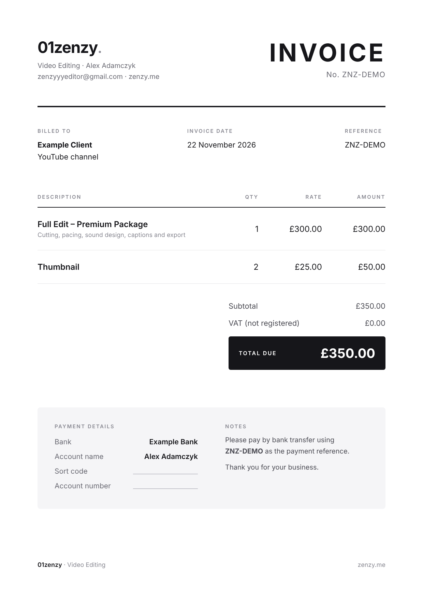

# invoice-gen

Clean, branded invoices as **PNG or PDF** from one command. Built because I was making freelance invoices by hand and wanted them to look professional every time.



## Features

- One command per invoice: client, line items, number, done
- Multiple line items with quantities and optional notes
- Optional VAT and due date (left off by default)
- Sender and bank details live in a git-ignored `config.toml`, so they never end up in the repo
- Renders HTML with Jinja2, exports with headless Chromium via Playwright
- Money handled with `Decimal` and half-up rounding, never floats

## Install

```bash
git clone https://github.com/Zenzyyy/invoice-gen
cd invoice-gen
pip install -e ".[dev]"
playwright install chromium
cp config.example.toml config.toml   # then fill in your details
```

## Usage

```bash
invoice-gen \
  --client "Example Client" --client-note "YouTube channel" \
  --item "Full Edit – Premium Package:300:1:Cutting, pacing, sound design, captions and export" \
  --item "Thumbnail:25:2" \
  --number ZNZ064
# wrote out/Invoice_ZNZ064.png  (total 350.00)
```

| Flag | What it does |
| --- | --- |
| `--item "desc:rate[:qty[:note]]"` | Add a line item (repeatable) |
| `--number` | Invoice number, also used as the payment reference |
| `--date YYYY-MM-DD` | Invoice date (default: today) |
| `--due-days N` | Add a due date N days after the invoice date |
| `--vat 0.2` | Add VAT at that rate |
| `--format png\|pdf` | Output format (default: png) |
| `--html` | Also save the rendered HTML |

## How it works

```
config.toml + CLI args ──► Invoice (dataclass, Decimal maths)
                              │
                              ▼
                 Jinja2 template (templates/base.html)
                              │
                              ▼
               Playwright / Chromium ──► PNG or PDF
```

## Tests

```bash
pytest
```

## Licence

MIT
